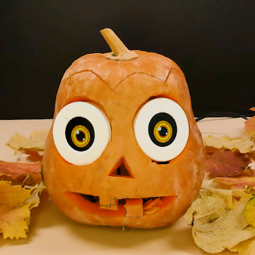
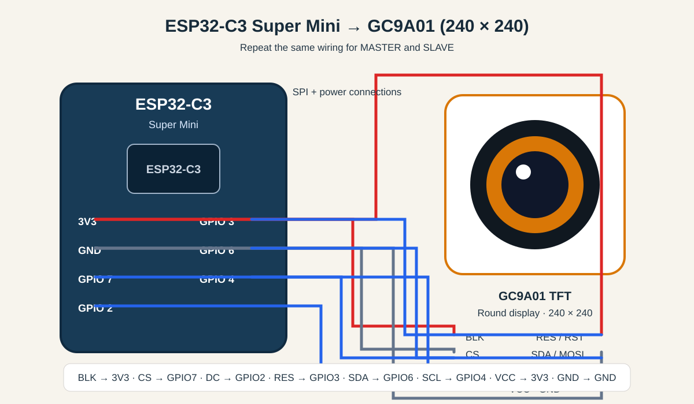

# 🎃 Halloween Pumpkin — Synchronized ESP32 Eyes

Bring a Halloween pumpkin to life with **two animated eyes** built from two ESP32-C3 boards and two round GC9A01 displays.

The eyes move and blink in sync. The **MASTER** generates the animation and sends eye position and eyelid state to the **SLAVE** over **ESP-NOW** — no Wi-Fi router required.

<p align="center">
  
</p>

> **Actual animated project preview:** the GIF above shows the pumpkin's animated eyes in action.

## ✨ Features

- Two synchronized animated eyes
- Smooth pupil movement
- Random gaze direction and blinking
- Wireless communication using ESP-NOW
- 240 × 240 GC9A01 round IPS displays
- Separate MASTER and SLAVE firmware
- Full-frame canvas rendering to reduce visible flicker

## 🧰 Hardware

| Qty | Component |
|---:|---|
| 2 | ESP32-C3 Super Mini |
| 2 | GC9A01 1.28-inch round TFT display, 240 × 240 |
| 2 | USB power source / suitable regulated 5 V supply |
| 2 | USB cable or wiring for power and programming |
|  | Jumper wires |
| 1 | Pumpkin / Halloween prop (optional, but highly recommended 🎃) |

> **Important:** The ESP32-C3 uses 3.3 V logic. Connect the display's VCC to 3V3 unless your exact display module explicitly supports another supply voltage. Do not connect 5 V logic signals to ESP32 GPIO pins.

## 🔌 Wiring: ESP32-C3 Super Mini → GC9A01

The wiring is identical for both boards. Use one set for MASTER and repeat it for SLAVE.

<p align="center">
  
</p>

| GC9A01 display | ESP32-C3 Super Mini | Description |
|---|---|---|
| BLK | 3V3 | Backlight |
| CS | GPIO 7 | Chip select |
| DC | GPIO 2 | Data / command |
| RES / RST | GPIO 3 | Reset |
| SDA / MOSI | GPIO 6 | SPI data |
| SCL / SCK | GPIO 4 | SPI clock |
| VCC | 3V3 | Display power |
| GND | GND | Ground |

**Repeat this exact connection for both displays.** The two ESP32-C3 boards communicate wirelessly via ESP-NOW; no wire is needed between the boards.

## 🧠 System architecture

```text
       MASTER                                      SLAVE
  ┌─────────────────┐                        ┌─────────────────┐
  │  ESP32-C3       │                        │  ESP32-C3       │
  │  Animation      │                        │  Receives state │
  │  Eye movement   │─── ESP-NOW, ch. 1 ───▶│  Draws same eye  │
  │  Blink timing   │                        │  position/blink │
  └────────┬────────┘                        └────────┬────────┘
           │ SPI                                      │ SPI
  ┌────────▼────────┐                        ┌────────▼────────┐
  │ GC9A01 240×240  │                        │ GC9A01 240×240  │
  │ Right eye       │                        │ Left eye        │
  └─────────────────┘                        └─────────────────┘
```

## 💻 Arduino IDE setup

### 1. Install the board package

Install **esp32 by Espressif Systems** using Boards Manager in Arduino IDE.

Select a suitable ESP32-C3 board, for example **ESP32C3 Dev Module**. The exact menu options can vary with the installed ESP32 Arduino core version.

### 2. Install the display library

Install **Arduino_GFX_Library** from Library Manager.

The firmware also uses ESP32 Arduino core components:
- `WiFi.h`
- `esp_now.h`
- `esp_wifi.h`
- `esp_arduino_version.h`

These are included with the ESP32 board package.

### 3. Upload the firmware

1. Open `firmware/Halloween_SLAVE_ESPNOW.ino`.
2. Select the SLAVE ESP32-C3 port and upload.
3. Open `firmware/Halloween_MASTER_ESPNOW.ino`.
4. Select the MASTER ESP32-C3 port and upload.
5. Power both boards.

Upload the SLAVE first so it is ready to receive packets when the MASTER starts.

## 📡 ESP-NOW configuration

Both sketches use:

```cpp
#define ESPNOW_CHANNEL 1
```

The MASTER sends packets to the SLAVE's MAC address. The current address in the MASTER firmware is:

```cpp
const uint8_t slaveMac[6] = {
  0xD4, 0x05, 0x92, 0xE7, 0xCB, 0x84
};
```

If you use a different SLAVE board, read its STA MAC address from the Serial Monitor (115200 baud) after startup, then replace the address in the MASTER sketch. Keep both devices on the same ESP-NOW channel.

## 🗂️ Repository structure

```text
Halloween_Pumpkin_ESP32_Eyes/
├── firmware/
│   ├── Halloween_MASTER_ESPNOW.ino
│   └── Halloween_SLAVE_ESPNOW.ino
├── docs/
│   ├── wiring.svg
│   └── pumpkin-preview.jpg
├── LICENSE
└── README.md
```

## 🔧 Troubleshooting

**The MASTER eye works, but the SLAVE does not move**
- Confirm both boards use the same ESP-NOW channel.
- Upload the SLAVE firmware first.
- Check the SLAVE STA MAC in Serial Monitor.
- Confirm the MAC address in the MASTER sketch matches the SLAVE.
- Open both Serial Monitors at **115200 baud** and check the startup messages.

**The display stays black**
- Check VCC, GND, BLK and all SPI connections.
- Confirm the GPIO assignments match the table.
- Make sure the display is powered from a suitable 3.3 V supply.
- Test the display and firmware on one board before troubleshooting ESP-NOW.

**Compilation fails**
- Confirm `Arduino_GFX_Library` is installed.
- Confirm the Espressif ESP32 board package is installed and an ESP32-C3 target is selected.

## 🎥 Project

Created for a DIY Halloween build by **SMD VIBE**.

If you build it, share your version and tag **SMD VIBE**!

---

## 📜 License

This project is released under the MIT License. See [LICENSE](LICENSE).
